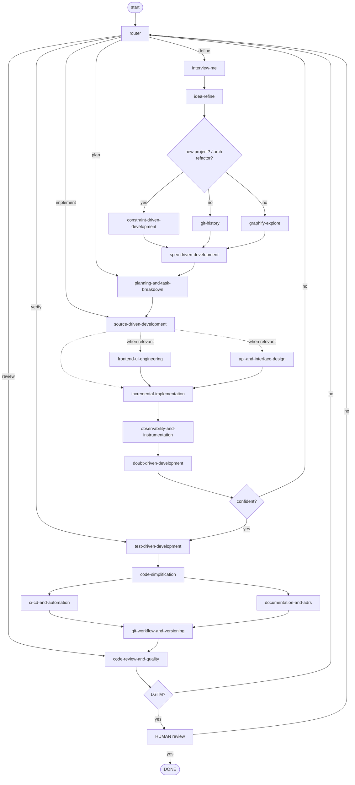

# J2 Agent

A [LangGraph](https://github.com/langchain-ai/langgraph) agent (TypeScript) inspired by
development lifecycle skills from [addyosmani/agent-skills](https://github.com/addyosmani/agent-skills).
Laid out per the
[LangGraph application structure](https://docs.langchain.com/oss/javascript/langgraph/application-structure).

## Architecture

A fixed lifecycle graph (**Define → Plan → Implement → Verify → Review**) with a
**router** that can enter at any phase and **decision gates** that loop back to it:



Each **phase is a LangGraph subgraph** (`define`, `plan`, `build`, `verify`, `review`)
added as a node to the top-level graph. The phases share one state schema, so no
input/output mapping is needed at the seams:

```
START -> router -> {define, plan, build, verify, review}
define -> plan -> build ; build -> (confident? verify : router)
verify -> review ; review -> (human_approved? DONE : router)
```

- **Node plugins** — each node is a self-contained module exposing `NAME` and
  `build(ctx)`. Skill nodes vendor their prompt (from `addyosmani/agent-skills`
  `SKILL.md`) as a `PROMPT` constant and run it through `ctx.provider`, giving the node a
  full agent loop with a coding toolset (Read / Edit / Bash / …). No skill cloning or
  runtime import — edit `PROMPT` to tune a node.
- **Providers** — the agent backend is pluggable via a `Provider` interface
  (`ctx.provider.run` / `ctx.provider.runJson`). Built in:
  **anthropic** ([Claude Agent SDK](https://code.claude.com/docs/en/agent-sdk)),
  **openai** ([OpenAI Agents SDK](https://openai.github.io/openai-agents-js/)),
  **ollama** (local, OpenAI-compatible API), and
  **openrouter** (hosted many-model, OpenAI-compatible API). The openai / ollama /
  openrouter providers share one OpenAI-compatible base (thin configs over it) and add a
  read/write/edit/bash toolset scoped to the working dir. Pick one at invoke time with
  `--provider` or `AGENT_PROVIDER`.
- **Exit contract** — each subgraph has one entry, keeps its clarify loops and fan-outs
  internal, and ENDs; the top-level graph routes to the next phase on shared state flags.
- **Router** (LLM) picks which phase to (re)enter; gates (`confident?`, `LGTM?`, human
  review) loop back to it.
- **H/A clarify loops** on `interview-me`, `idea-refine`, `spec-driven-development`:
  the node may ask the human one question (`human-clarify` interrupt), the answer is
  added to context, then it re-evaluates.
- **Parallel branches**: `git-history` + `graphify-explore` gather context together;
  `ci-cd-and-automation` + `documentation-and-adrs` run together.
- **Control nodes** (not skills): `router`, `classify-project`, `git-history`,
  `graphify-explore`, `human-clarify`, `human-review`.

## Project structure

```
src/
├── graph.ts                    # top-level: router + 5 phase subgraphs + exit routing
├── cli.ts                      # CLI runner (human-in-the-loop from the terminal)
├── state.ts                    # shared cross-phase state — Zod schema (withLangGraph reducers)
├── core/                       # node plugin framework
│   ├── provider.ts             # Provider interface + resolveProvider(name)
│   ├── providers/
│   │   ├── anthropic.ts        # Claude Agent SDK provider (run, runJson)
│   │   ├── openai_compat.ts    # shared OpenAI-compatible base (+ coding toolset)
│   │   ├── openai.ts           # thin config: OpenAI API
│   │   ├── ollama.ts           # thin config: local Ollama /v1
│   │   └── openrouter.ts       # thin config: OpenRouter /v1
│   ├── parse.ts                # shared output-parsing helpers (SUMMARY/VERDICT/…)
│   ├── node.ts                 # NodeContext (holds the provider) + node types
│   └── index.ts                # framework re-exports
└── phases/
    ├── define/                 # interview-me, idea-refine, classify-project, git-history,
    │   ├── <node>.ts           #   graphify-explore, constraint-*, spec-*, human-clarify
    │   └── graph.ts            # wires the define subgraph
    ├── plan/                   # planning-and-task-breakdown
    ├── build/                  # source-*, frontend-ui, api-*, incremental-*, observability-*, doubt-*
    ├── verify/                 # test-*, code-simplification, ci-cd-*, documentation-*
    └── review/                 # git-workflow-*, code-review-*, human-review
langgraph.json                  # LangGraph config (points at src/graph.ts:graph)
package.json                    # dependencies + scripts
tsconfig.json                   # TypeScript config
.env                            # environment variables (see .env.example)
```

Each phase directory has one file per node plus a `graph.ts` that wires that phase's
subgraph. A node file is a plugin: `NAME`, a `PROMPT` (vendored SKILL.md for skill
nodes), and `build(ctx)`. Edit a single file to change one node without touching others.

## Setup

```bash
bun install
cp .env.example .env    # set AGENT_PROVIDER and provider credentials
```

`bun install` pulls in both provider SDKs (`@anthropic-ai/claude-agent-sdk`,
`@openai/agents`) plus `@langchain/langgraph`. No skill repo to clone — prompts are
vendored into the node files. Per provider:

- **anthropic**: the Claude Code CLI it drives must be installed and authenticated
  (`claude --version`).
- **openai**: set `OPENAI_API_KEY` (and optionally `OPENAI_MODEL`).
- **ollama**: run a local Ollama server with a tool-capable model
  (`ollama pull llama3.1`); optionally set `OLLAMA_HOST` / `OLLAMA_MODEL`.
- **openrouter**: set `OPENROUTER_API_KEY` and `OPENROUTER_MODEL` (a `vendor/model` id
  that supports tool calling).

## Run

### LangGraph dev server / Platform

`langgraph.json` exposes the compiled graph as `skills_agent`:

```bash
bunx @langchain/langgraph-cli dev
```

Build-time config comes from `.env` (`AGENT_PROVIDER`, `AGENT_MODEL`,
`AGENT_PERMISSION_MODE`).

### Print the graph

Emit Mermaid for the top-level graph and every phase subgraph (no credentials needed):

```bash
npm run graph        # or: bun run src/mermaid.ts
```

### CLI

```bash
# via bun (runs TypeScript directly, no build step)
bun run src/cli.ts "Add a --json flag to the CLI and cover it with tests" \
    --provider openai \
    --workdir /path/to/target/project

# or build first, then run the compiled output
bun run build
bun dist/cli.js "..." --provider anthropic --workdir /path/to/target/project
```

The CLI answers human-in-the-loop interrupts (clarify questions, final review) from the
terminal.

Node calls are logged to **stderr** (`▶ <node>`); set `LOG_LEVEL=debug` for per-call
timing, updated state keys, and the **full context (system + prompt) sent to the LLM** on
every provider call, or `LOG_LEVEL=warn` to quiet it. Logging is applied by wrappers at
the seams — `traced()` around nodes at graph assembly, and a provider wrapper in
`resolveProvider` — so node bodies contain no logging calls.

| Flag | Default | Meaning |
|------|---------|---------|
| `--provider` | `anthropic` (or `$AGENT_PROVIDER`) | Agent backend: `anthropic` \| `openai` \| `ollama` \| `openrouter` |
| `--workdir` | cwd | Project dir where skill nodes read/edit files |
| `--permission-mode` | `acceptEdits` | anthropic only: `default` \| `acceptEdits` \| `plan` \| `bypassPermissions` |
| `--model` | provider default | e.g. `sonnet`/`opus` (anthropic), `gpt-5.5` (openai) |
| `--recursion-limit` | 100 | Max graph super-steps (gates can loop back to the router) |

## Safety

Skill nodes have real file and shell access through the chosen provider (Claude Code
tools for anthropic; the read/write/edit/bash toolset for openai). Control blast
radius with `--permission-mode` (anthropic) and run against a git-clean working tree so you can
diff and revert. Use `bypassPermissions` only inside a sandbox.
